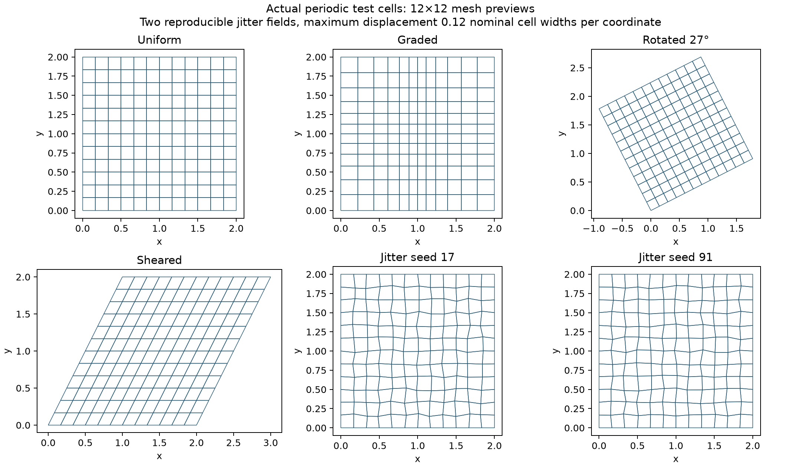
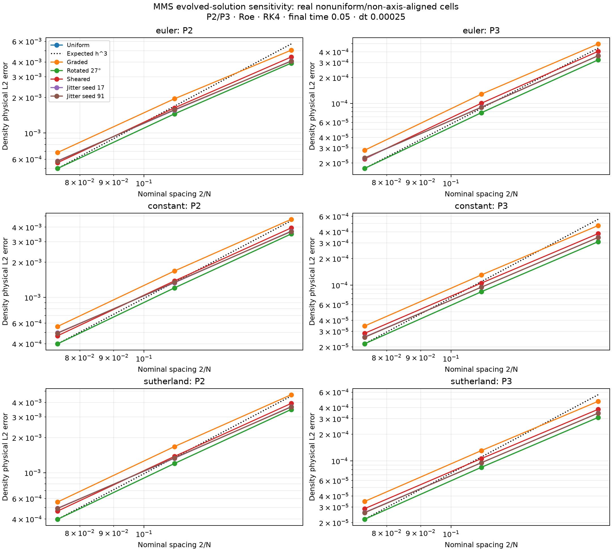

# MMS sensitivity to cell geometry

This supplemental study measures how real cell geometry affects smooth CPG MMS
solutions. It is separate from the 270-group GPU regime campaign. It uses the
production Euler/CNS operators and MFEM RK4 directly in a one-rank CTest fixture;
it does not add another solver launcher or test MPI partitioning.

## Existing coverage and what is added

| Existing check | Coverage | New study adds |
| --- | --- | --- |
| Cyclic MMS orientation study | Axis/momentum permutations on a uniform Cartesian cube | Actual 27-degree rotation of a quadrilateral mesh and matching physical state/forcing |
| BR1 gradient fixture | Uniform periodic Cartesian refinement and mean-speed changes | Graded, sheared and seeded-jitter cell geometry |
| Axisymmetric geometry tests | Curved radius caches, radial derivatives, 3D subcell metric equivalence | Coupled Cartesian MMS evolution on conforming distorted meshes |
| Viscous volume/face kernels | Synthetic off-diagonal metrics and non-axis-aligned normals | Real mesh metrics, faces and gradients assembled through the production operator |

## Experiment

- 2D periodic quadrilaterals, Roe flux, P2/P3 and 12/18/27 cells per direction.
- Euler, constant CNS and Sutherland CNS; original MMS mean speed.
- RK4 to $t_f=0.05$ with fixed $\Delta t=0.00025$ (200 steps); FV blending off.
- Physical error norms use actual element transformations and Gauss quadrature,
  with a 12-versus-10-point quadrature check. The uniform-grid visualization norm
  reconstruction is not used on these meshes.

| Mesh family | Definition |
| --- | --- |
| Uniform | Square $[0,2]^2$ reference mesh |
| Graded | $x'=x+0.35\sin(\pi x)/\pi$, $y'=y+0.25\sin(\pi y)/\pi$ at vertices; rectangular cells with varying sizes |
| Rotated | Rigid 27-degree rotation of mesh, exact velocity and momentum forcing; gradients transformed as scalars/vectors/tensors as appropriate |
| Sheared | $x'=x+0.5y$, $y'=y$; periodic shifts $(2,0)$ and $(1,2)$ preserve the exact field's unit periodicity |
| Jitter 17/91 | Reproducible integer-hash vertex fields, displacement at most $0.12h$ per coordinate, boundary vertices pinned |

Grading is fixed under refinement. Jitter displacements scale with nominal
$h=2/N$; the seed remains fixed but the meshes are not nested. All areas remain
four. The two random seeds are examples, not a statistical robustness survey.



## Results and limits

The extended study exercised **108 operator evolutions**. Free-stream, positive
geometry/physical-state, gradient-refinement, quadrature and rotation-covariance
checks passed. The maximum free-stream RHS was $3.53\times10^{-12}$; rotation
changed conservative error norms by at most $6.15\times10^{-12}$ relatively.
Minimum cell Jacobian was about 0.488 of the uniform reference value. The largest
sampled maximum/minimum Jacobian ratio was 3.44.

At the finest tested mesh, the ranges across quantities, degrees and models were:

| Geometry change | Error amplification over matching uniform case |
| --- | --- |
| Grading | 1.36–2.08 times |
| Shear | 1.12–1.46 times |
| Jitter, seed 17 | 1.16–1.37 times |
| Jitter, seed 91 | 1.15–1.36 times |



Uniform and rotated curves overlap. These results support rigid-rotation
invariance and quantify modest error amplification for the tested distortions.
They do not establish that mesh distortion is accuracy-neutral.

**Order observations are retained:** 27 component comparisons in 20 of 36
refinement groups fall below the strict nominal-minus-0.5 comparison. The extended
fixtures return nonzero for those flags. Some uniform short-time CNS P3 density
baselines also flag; jitter introduces additional density-rate reductions. For
example, Euler P2 density rates are 2.630 on uniform cells and 2.442/2.477 on the
two jitter fields. Constant-CNS P3 density is 3.345 on uniform cells and
3.200/3.219 on the jitter meshes. These observations do not by themselves identify
an implementation defect or establish asymptotic order.

BR1 primitive-gradient finest rates remain at least 1.950 for P2 and 2.921 for P3,
above their respective $p-0.5$ checks. See the [retained measurements and flags](assets/mms/mesh-sensitivity/measurements.json).
This evidence covers mild 2D periodic Q1 distortions, one flux and one mean-speed
family; it does not establish arbitrary mesh quality, high-order curved geometry,
walls, triangles, 3D or every flux/regime. CPU execution does not establish CUDA
runtime correctness; eligible builds register device fixtures.

## Repeat the checks and generate pictures

Configure a Cartesian build with testing enabled and the declared dependency
prefix, then build the two dedicated targets. Each target has its own transport
selection; both can be built in the same build directory.

```bash
cmake --build "$BUILD" --target \
  mms_mesh_sensitivity_constant_tests mms_mesh_sensitivity_sutherland_tests -j 4
ctest --test-dir "$BUILD" --output-on-failure -R '^MMSMeshSensitivity_.*_CPU$'
```

The default **quick profile** executes 18 P2/12-cell cases in total and checks
geometry, free stream, physical evolution, quadrature and rotation covariance.
It does not qualify a refinement order. The local Release CPU run took about
13.5 seconds. The central runner discovers these CTests; no full refinement sweep
is automatically added to quick CI.

For the **extended profile**, retain all cases and their flags in a fresh evidence
directory. These commands run about five minutes on the tested CPU. A nonzero
exit from an order flag does not remove the output JSON; inspect both files.

```bash
mkdir -p "$EVIDENCE"
"$BUILD/tests/mms_mesh_sensitivity_constant_tests" cpu \
  "$EVIDENCE/constant.json" extended > "$EVIDENCE/constant.log" 2>&1
"$BUILD/tests/mms_mesh_sensitivity_sutherland_tests" cpu \
  "$EVIDENCE/sutherland.json" extended > "$EVIDENCE/sutherland.log" 2>&1
"$PYTHON" "$THESEUS_SOURCE/tests/mms/mesh_sensitivity_study.py" \
  --input "$EVIDENCE/constant.json" "$EVIDENCE/sutherland.json" \
  --output "$EVIDENCE/plots"
```

Run the commands separately if the shell exits on the first nonzero status.
CUDA builds support `cuda` in place of `cpu`, with the normal site GPU environment.
The postprocessor writes mesh previews, density plots, complete numerical records
and HTML/Markdown reports without rerunning the operator. Original unit-test
measurements and plots are recorded with [provenance](assets/mms/mesh-sensitivity/provenance.json).
