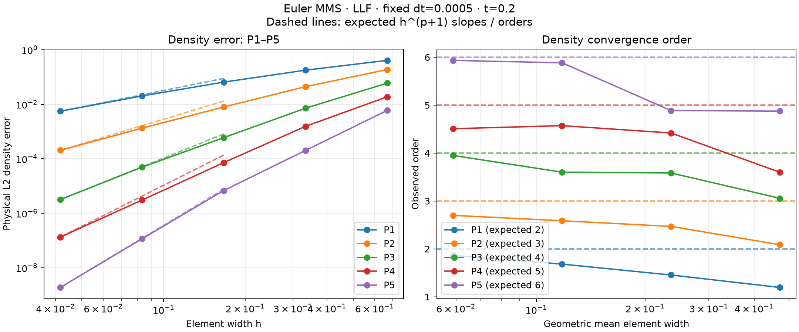
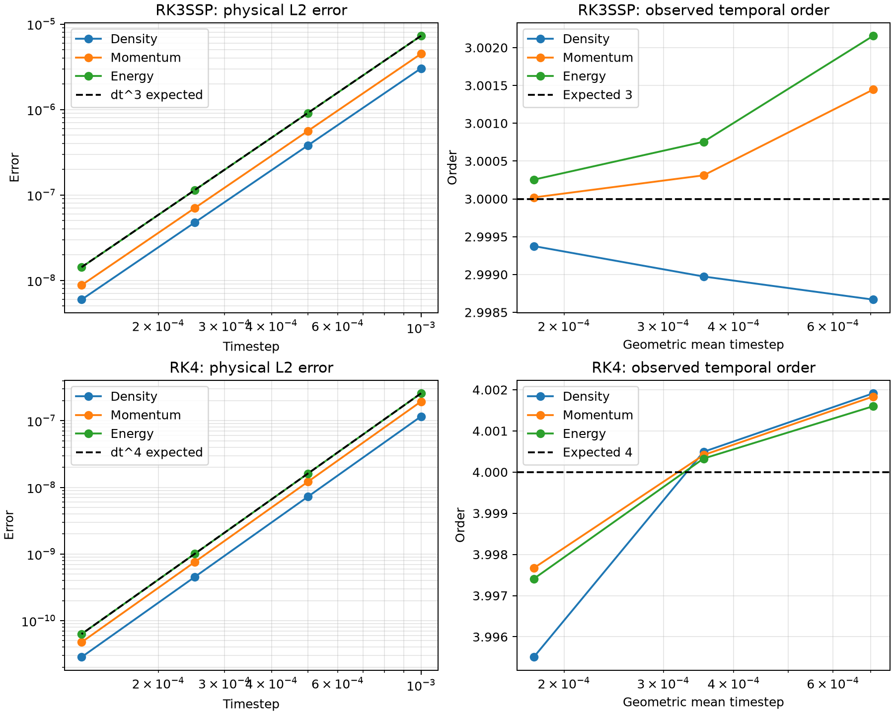
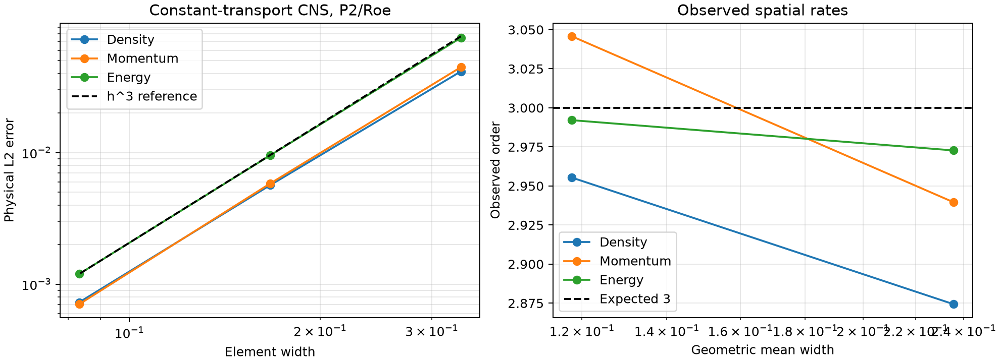
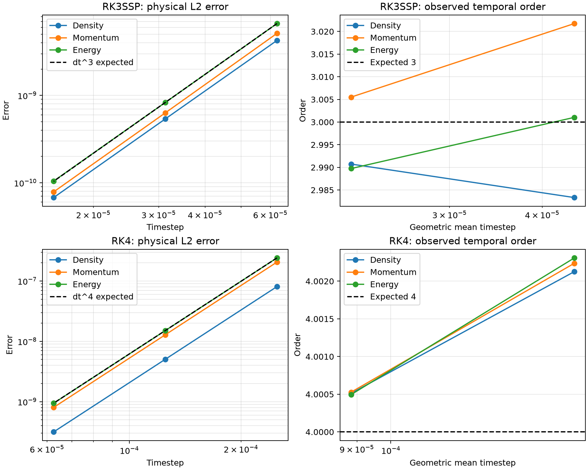
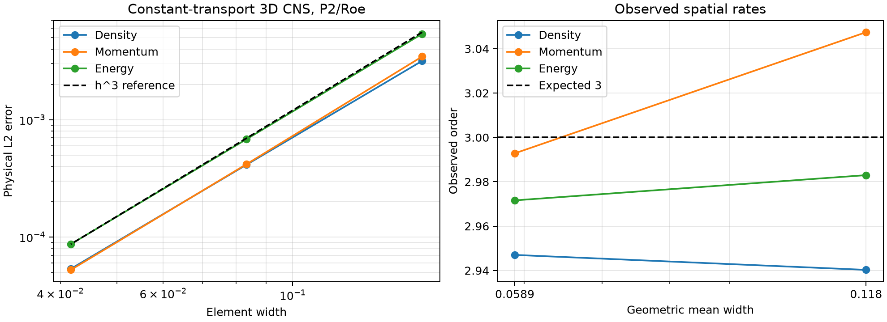
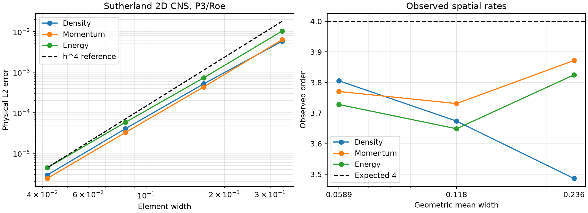
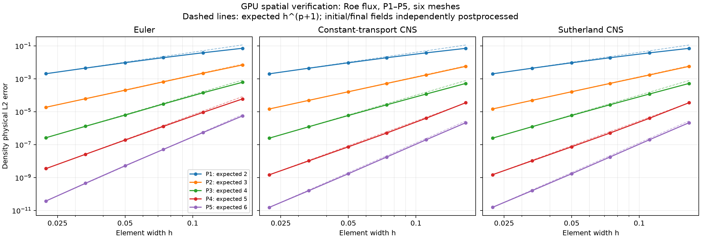
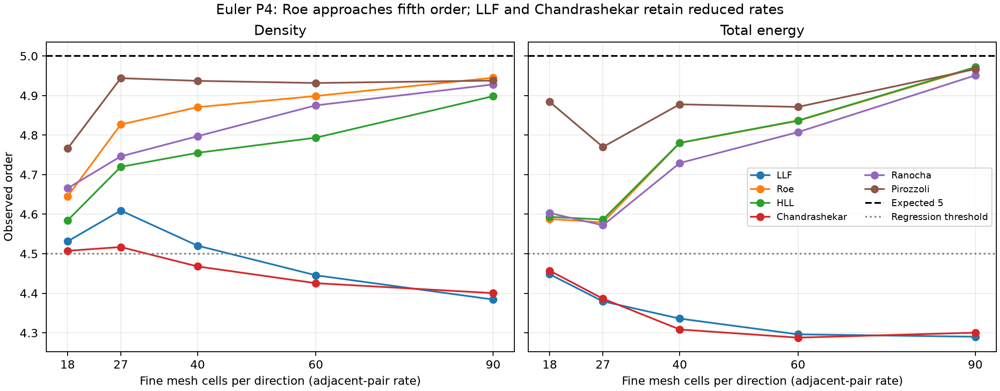

# Manufactured-solution verification

The method of manufactured solutions (MMS) prescribes a smooth exact state,
substitutes it into the desired equations, and adds the resulting residual as a
source. Solving this forced problem gives a known reference for error and
convergence measurements. Spatial and temporal refinement, independent source
checks, and controls for competing errors provide evidence that the code solves
the intended equations at the measured order.

Roy et al. [[1]](#ref-roy) is the foundational Euler/CNS reference for this
effort. The current fields are a Roy-style trigonometric variant; selected cases
with Roy's published coefficients are planned. MASA (Manufactured Analytical
Solution Abstraction) [[2]](#ref-masa)[[3]](#ref-masa-paper) provides Euler/CNS and
other PDE solutions with C++, C, Python and Fortran interfaces. It is a candidate
for additional cases and independent references, with no current Theseus build
or runtime dependency. Navah and Nadarajah [[4]](#ref-navah) provide high-order
context for mixed modes and balancing forcing contributions.

**Major points**

- MMS verifies implementation and observed convergence for a specified configuration.
- Roy cases and possible MASA reuse are planned additions, not current dependencies.
- This guide covers solution definitions and evidence; [repeating the evaluations](mms-evaluations.md) contains commands and testing matrices.

## Governing equations

See [Governing equations](theory.md) for the conservation laws, inviscid and
viscous fluxes, stress, heat flux and gas-model context. The tests here select
Cartesian calorically perfect gas (CPG) Euler or compressible Navier–Stokes (CNS),
with periodic boundaries. The following section specifies their exact fields,
physical fluxes and forcing in solver state order.

**Artifacts and scope**

- [Governing-equations reference](theory.md).
- [Source-term interface](source-terms.md).
- Current evidence: periodic CPG Euler and constant-transport CNS; Sutherland adds independently checked forcing and the 2D P3/Roe spatial evidence below. LTE and wall-boundary accuracy are not established.

### Equation and discrete-operator coverage

Coupled MMS convergence exercises the assembled discrete equations. Direct
component checks provide additional evidence for particular formulas or operator
paths; coupled coverage alone does not isolate each component. The table describes
available evidence, not a promise that every study runs in quick CI.

| Component | Coupled MMS coverage | Direct checks and limits |
| --- | --- | --- |
| Conservation laws | Density, vector momentum and total energy for Euler and CNS, with analytic forcing | Independent source/reference checks; spatial convergence for Euler, constant CNS and Sutherland CNS |
| CPG equation of state | Pressure, temperature and energy relations entering fluxes and transport; $\gamma=1.4$ | Source/reference checks use analytic CPG relations. No LTE or real-gas MMS coverage |
| Inviscid volume and face fluxes | Combined contribution to evolved solutions with LLF, Roe, HLL, Chandrashekar, Ranocha and Pirozzoli flux choices | Separate Riemann/scalar-penalty checks; MMS does not isolate every volume/face contribution. Euler P4 LLF/Chandrashekar order exceptions remain documented |
| BR1 gradient pathway | Entropy-variable gradients and their conversion to primitive gradients feed the CNS viscous fluxes | Production-path test compares both directional gradients of density, both velocities and pressure with analytic derivatives: 2D periodic Cartesian P2/P3, $6^2$ and $12^2$ meshes, observed gradient order at least $p-0.5$. Constant gradients and constant-state CNS RHS must vanish within $10^{-11}$. This checks the combined pathway, not BR1 in isolation |
| Newtonian viscous stress | Velocity-gradient stresses enter momentum transport and viscous work in total energy | Independent CNS forcing/derivative references and viscous-contribution controls supplement coupled convergence; not a standalone refinement study of every stress component |
| Fourier heat conduction | Temperature-gradient heat flux enters the energy equation | Analytic forcing/reference checks and coupled constant/Sutherland CNS studies; no independently varied conductivity-law family |
| Constant transport | Constant dynamic viscosity with conductivity set through the CPG heat capacity and prescribed Prandtl number | Transport/source consistency, zero-transport Euler limit and build/source mismatch checks |
| Sutherland transport | Temperature-dependent viscosity and associated conductivity, including coefficient-gradient contributions in the forcing | Independent variable-transport checks and omission controls; 2D P1–P5/all-flux spatial evidence. Temporal and coupled 3D accuracy remain untested |
| Time integration and source coupling | Forced evolution with SSPRK3 and RK4 | Separate Euler and constant-CNS temporal studies recover approximately third and fourth order; half-timestep controls bound temporal contamination in spatial studies |
| Dimension, geometry and boundaries | Primarily 2D periodic Cartesian studies; selected constant-CNS 3D P2/Roe spatial evidence | No wall-boundary, curved-geometry or axisymmetric MMS accuracy claim. Direct gradient refinement is currently 2D |

**Coverage summary**

- Coupled tests exercise inviscid transport, BR1-based viscous transport, stress,
  heat conduction and source integration for the specified CPG configurations.
- Direct component checks strengthen that evidence but have their own dimensional,
  degree and geometry limits. The [capability inventory](mms-inventory.md) identifies
  implementations and test entry points; [evaluation workflows](mms-evaluations.md)
  distinguish quick, qualification and extended studies.
- Coverage is for smooth solutions. Distinct Mach-regime families, LTE, shocks and
  boundary accuracy are not established by this MMS campaign.

## Current manufactured solutions

### Exact fields, fluxes, RHS and parameters

#### Shared multidirectional trigonometric family

For field index $a=0,1,2,3,4$ corresponding to $\rho,u,v,w,p$, define

$$
\begin{aligned}
X_a &= 2\pi(x-0.20\sigma t)+0.17a,\\
Y_a &= 2\pi(y+0.13\sigma t)+0.29a,\\
Z_a &= 2\pi(z-0.11\sigma t)+0.31a,\\
q_a &= q_{0,a}+A_{x,a}\sin X_a+A_{y,a}\cos Y_a
       +A_{xy,a}\sin X_a\cos Y_a\\
    &\quad+A_{z,a}\sin Z_a+A_{xz,a}\cos X_a\sin Z_a
       +A_{yz,a}\sin Y_a\cos Z_a.
\end{aligned}
$$

Omit the three terms involving $Z_a$, and the velocity $w$, in 2D.
The positive time scale $\sigma$ defaults to 1. Changing it scales phase time
and all analytic time derivatives, while leaving spatial frequencies unchanged.

| Field | $q_0$ | $A_x$ | $A_y$ | $A_z$ | $A_{xy}$ | $A_{xz}$ | $A_{yz}$ |
| --- | ---: | ---: | ---: | ---: | ---: | ---: | ---: |
| $\rho$ | 2.0 | .12 | .08 | −.06 | .04 | .03 | −.02 |
| $u$ | .7 | .07 | −.04 | .03 | .02 | −.02 | .01 |
| $v$ | .3 | −.05 | .06 | −.04 | .03 | .01 | −.02 |
| $w$ | .2 | .04 | −.03 | .05 | −.02 | .03 | .02 |
| $p$ | 1.0 | .08 | −.06 | .04 | .03 | −.02 | .02 |

These fields and their derivatives are unit-periodic in each direction, with
$\rho\ge1.65$ and $p\ge0.75$ for all positions and times. Independent directional
and mixed modes exercise distinct derivatives, including third momentum in 3D.
This is a Roy-style trigonometric variant [[1]](#ref-roy), with periodic,
unsteady fields and mixed products suited to these tests. Mixed products and
forcing balance also follow the high-order verification considerations of
Navah and Nadarajah [[4]](#ref-navah). It does not reproduce either paper's
coefficient set.

#### Relationship to Roy's published solutions

Roy's Appendix A, Eq. (A1), defines the same primitive variables as means plus
sine/cosine variations in $x$, $y$ and $xy$ [[1]](#ref-roy). The relationship is
close; the differences are the chosen functions, parameters and test setup:

| Feature | Roy (2004) | Current Theseus variant |
| --- | --- | --- |
| Mixed term | Functions of $xy/L^2$, e.g. $\cos(a\pi xy/L^2)$; enabled in the CNS case, zero coefficients in the Euler case | Products such as $\sin X\cos Y$, with $xz$ and $yz$ products in 3D |
| Time and dimension | Steady 2D examples | Translating phases in 2D/3D, with optional time scaling |
| Spatial frequencies | Field- and direction-dependent multipliers of $\pi/L$ | Common $2\pi$ spatial frequency with field-dependent phase offsets |
| Parameters | $\gamma=1.4$, $R=287$; CNS $\mu=10$, $\mathrm{Pr}=1$; separate supersonic Euler and subsonic CNS coefficient sets | $\gamma=1.4$, $R=1$; CNS $\mu=0.02$, $\mathrm{Pr}=0.72$; shared field coefficients above |
| Boundaries | Inflow/outflow treatment, including exact prescribed values | Periodic boxes |

Roy therefore already exercises mixed derivatives in his viscous solution; the
mixed-coordinate dependence is not a new feature of our family. Our products
keep the fields and derivatives periodic, while the translating phases allow
temporal verification. This is an adaptation within the same broad construction,
not a literal Roy benchmark reproduction. The parameter sets use different
field scales; viscosity values alone do not compare the strength of viscous
and convective contributions.

#### Physical fluxes and manufactured RHS

Let $d$ be the dimension, $\mathbf{u}$ the velocity, $\mathcal{E}=\rho E$ the
total energy density, and $\gamma=1.4$. In solver order,

$$
U=(\rho,\rho u_1,\ldots,\rho u_d,\mathcal{E})^T,
\qquad
\mathcal{E}=\frac{p}{\gamma-1}+\frac{\rho}{2}\sum_{i=1}^d u_i^2.
$$

For direction $j$, the expected physical fluxes are

$$
F_j^I=
\begin{pmatrix}
\rho u_j\\
\{\rho u_i u_j+p\delta_{ij}\}_{i=1}^d\\
(\mathcal{E}+p)u_j
\end{pmatrix},
\qquad
F_j^V=
\begin{pmatrix}
0\\
\{\tau_{ij}\}_{i=1}^d\\
\sum_{i=1}^d u_i\tau_{ij}+\kappa\,\partial_jT
\end{pmatrix}.
$$

For CNS,

$$
\begin{aligned}
T&=\frac{p}{\rho R},\qquad
\kappa=\frac{\mu c_p}{\mathrm{Pr}},\qquad c_p=\frac{\gamma R}{\gamma-1}=3.5R,\\
\theta&=\sum_{k=1}^d\partial_k u_k,\qquad
\tau_{ij}=\mu\left(\partial_j u_i+\partial_i u_j-\frac{2}{3}\delta_{ij}\theta\right).
\end{aligned}
$$

The factor $2/3$ is retained in both 2D and 3D. For Euler set $F^V=0$.
The exact forcing and the semidiscrete RHS convention are

$$
S=\partial_tU+\sum_{j=1}^d\partial_j(F_j^I-F_j^V),
\qquad
R(U,t)=-\sum_{j=1}^d\partial_j(F_j^I-F_j^V)+S.
$$

Thus $R(U,t)=\partial_tU$ for the manufactured state. More explicitly, let
$D_i=\sum_j\partial_j\tau_{ij}$ and
$D_E=\sum_j\partial_j(\sum_i u_i\tau_{ij}+\kappa\partial_jT)$; both vanish for Euler.
Then

$$
\begin{aligned}
S_\rho&=\partial_t\rho+\sum_j\partial_j(\rho u_j),\\
S_{\rho u_i}&=\partial_t(\rho u_i)+\sum_j\partial_j(\rho u_i u_j)+\partial_i p-D_i,\\
S_{\mathcal{E}}&=\partial_t\mathcal{E}+\sum_j\partial_j((\mathcal{E}+p)u_j)-D_E.
\end{aligned}
$$

Sources evaluate these physical rates at the current RK-stage time, without
extra quadrature weights or mesh Jacobians. Euler uses analytic first derivatives;
constant-transport CNS also uses closed-form primitive Hessians for stress
divergence and the temperature Laplacian. Independent finite differences of
physical fluxes check the source; the CNS fixture checks all Hessian entries in
2D/3D. These physical fluxes do not prescribe a numerical interface flux: the
recipes select LLF, Roe or another production flux as documented in the matrices.

#### Flow-speed regimes

The same periodic fields support `subsonic`, `transonic` (default), and
`supersonic` regimes. Only the means of the active velocity components change:

$$
\overline{\boldsymbol{u}}_r=s_r\overline{\boldsymbol{u}},\qquad
s_{\mathrm{sub}}=0.25,\quad s_{\mathrm{trans}}=1,\quad s_{\mathrm{super}}=5.
$$

Density, pressure, oscillation amplitudes and phase speeds remain unchanged.
Velocity derivatives are unchanged; nonlinear inviscid fluxes and viscous work
are recomputed with the new velocity values. This is a forced manufactured family,
not a Galilean transformation of the complete space-time solution.

| Regime | Conservative 2D Mach bounds, all positions/times | Conservative 3D bounds | Selection |
| --- | --- | --- | --- |
| Subsonic | 0.0466–0.5182 | 0–0.7804 | `--regime subsonic` |
| Transonic | 0.6136–1.3044 | 0.5029–1.6418 | `--regime transonic` (default) |
| Supersonic | 3.7669–5.5305 | 3.5380–6.3394 | `--regime supersonic` |

These are triangle-inequality enclosures, not measured extrema. In 2D, initial
samples of the transonic field occur on both sides of Mach one. The bounds establish
positive density/pressure and Mach above three for the supersonic case independently
of mesh resolution and final time. A zero lower speed bound does not imply a vacuum.
No whole-domain transonic classification is claimed here for 3D.

The source option `regime` applies to all three trigonometric source types. For
non-default regimes, initial and exact states use `RegimeTrigonometricMMS`,
`signature: 1`, with `params: {"x1": 0}` for subsonic or `{"x1": 2}` for supersonic
(`1` selects the original state). State and source selections must agree. The
regime state function uses the original phase-time scale of one; the matrix does
not combine it with temporal acceleration. Existing source/state inputs remain valid.

**Artifacts and scope:** matrix plans retain conservative Mach bounds and sampled
initial Mach ranges; assessments reject mixed regimes. Separate result directories
keep regime studies independent. The original transonic data are the existing
baseline; no new-regime convergence result is implied by the analytic bounds alone.

#### Variable-transport extension

The separate `trigonometric-cns-sutherland-mms` source uses the same exact fields
and the solver's [Sutherland transport law](../include/Transport.hpp):

$$
\begin{aligned}
\mu(T)&=\mu_0\frac{T_0+T_s}{T+T_s}\left(\frac{T}{T_0}\right)^{3/2},
& T_0&=273.15,\quad T_s=110.4,\\
\partial_j\mu&=\mu\left(\frac{3}{2T}-\frac{1}{T+T_s}\right)\partial_jT,
&\partial_j\kappa&=\frac{c_p}{\mathrm{Pr}}\partial_j\mu.
\end{aligned}
$$

Its forcing includes both the constant-coefficient derivatives evaluated at local
transport values and the product-rule contributions from $\partial_j\mu$ and
$\partial_j\kappa$. It requires a `SUTHERLAND=ON` build and reads runtime `mu0`;
the solver's runtime `mu` does not select viscosity in that build. The
constant-transport source continues to reject Sutherland builds, and the
Sutherland source rejects constant-transport builds.

Initial/exact functions remain `TrigonometricCNSMMS` or its time-scaled state
alias. Independent source/transport checks cover 2D/3D and the zero-viscosity limit.
The coupled 2D P3/Roe study below passes its stated spatial and control gates;
Sutherland temporal and coupled 3D accuracy remain untested. An independent sampled
contribution audit uses $R=1/600$, $\mu_0=0.02$, $\mathrm{Pr}=0.72$: temperatures
approximately 255–337 and viscosity 0.0190–0.0235 make coefficient variation
visible without changing the conservative exact state. These are manufactured
gas parameters, not a physical-air configuration.

The diagnostic source options `viscous_scale=0` and
`coefficient_gradient_scale=0` respectively omit all viscous forcing or only its
coefficient-gradient terms; they do not change solver transport. Both default to 1.

#### Runtime selection

| Problem | Initial/exact function | Source type | Restrictions |
| --- | --- | --- | --- |
| Euler | `TrigonometricEulerMMS`, signature 0 | `trigonometric-euler-mms` | Cartesian 2D/3D CPG Euler; $\gamma=1.4$, $R=1$, $d+2$ equations |
| Constant-transport CNS | `TrigonometricCNSMMS`, signature 0 | `trigonometric-cns-mms` | Cartesian 2D/3D CPG `navier-stokes`; $\gamma=1.4$, $R>0$, $\mathrm{Pr}>0$, constant $\mu\ge0$ |
| Sutherland CNS | Same CNS state functions | `trigonometric-cns-sutherland-mms` | Same CPG/layout restrictions, $R>0$, $\mathrm{Pr}>0$, nonnegative `mu0`; Sutherland build required |
| Time-scaled state, either PDE | `TemporalTrigonometricEulerMMS`, signature 1, `params.x1` $=\sigma$ | Corresponding source with `time_scale` $=\sigma$ | Positive finite scale; initial/exact and source scales must match |

Configure sources through `runTime.sources`, for example
`[{"type":"trigonometric-cns-mms"}]`. CNS reads runtime `mu`, `Pr` and `R_gas`
and rejects Sutherland builds or other unsupported physics. Study values are
$\mu=0.02$, $\mathrm{Pr}=0.72$, $R=1$; Euler uses $R=1$. The diagnostic CNS
source option `viscous_scale=0` omits viscous forcing only, leaving solver transport
active; ordinary runs use its default 1.

**Artifacts and major points**

- Exact Euler fields/source: [TrigonometricEulerMMS.hpp](../include/verification/mms/TrigonometricEulerMMS.hpp).
- CNS Hessians/source: [TrigonometricCNSMMS.hpp](../include/verification/mms/TrigonometricCNSMMS.hpp); runtime checks: [TrigonometricCNS.hpp](../include/verification/mms/sources/TrigonometricCNS.hpp).
- Source oracles, production BR1 gradients, constant-state RHS and zero-transport Euler-limit checks supplement coupled convergence.
- The older single-phase [periodic Euler case](../TestCases/Euler/2D/PeriodicMMS/README.md) remains a separate baseline.

### Numerical results

These archived figures describe the configurations in their captions. They are
not automatically refreshed by later runs. Dashed references indicate nominal
slopes, with arbitrary normalization: $h^{p+1}$ for nominal evolved spatial
accuracy and $\Delta t^s$ for an order-$s$ time integrator. Headline momentum is the physical $L_2$
norm of the momentum **error vector**; component measurements remain available.
Images and measurements are stored with this guide, independently of disposable
validation builds. [Provenance and hashes](assets/mms/provenance.json) identify them.

#### Euler spatial convergence, P1–P5

Periodic $[-1,1]^2$, LLF, $\gamma=1.4$, $R=1$, 3/6/12/24/48 cells per direction,
RK4, fixed $\Delta t=0.0005$, $t_f=0.2$. Finest density rates are
1.864/2.700/3.951/4.509/5.935 against nominal orders 2/3/4/5/6. This is an
observational survey, not a claim of nominal order for every component/degree.
Finest half-timestep controls change component errors by at most
$2.59\times10^{-7}$ relative. FV blending was compiled on with `alpha_max=0`;
selected P2/P4 cases reproduce with blending compiled off.
[Measurements](assets/mms/euler-spatial-measurements.json);
recipe `mms-euler-spatial-survey`.

#### Euler temporal convergence

Periodic 2D, P15 on $6\times6$ cells, $\sigma=126$, $t_f=0.2$,
$\Delta t=0.001/0.0005/0.00025/0.000125$, with P17 finest-step spatial controls.
Finest density/momentum/energy rates are 2.9994/3.0000/3.0003 for RK3SSP and
3.9955/3.9977/3.9974 for RK4. Both temporal and spatial-floor checks pass.
[Measurements](assets/mms/euler-temporal-measurements.json);
recipe `mms-euler-temporal-survey`.

#### Constant-transport CNS spatial convergence

Periodic $[-1,1]^2$, P2/Roe, $\mu=0.02$, $\mathrm{Pr}=0.72$, $R=1$,
6/12/24 cells per direction, RK4, $\Delta t=0.001$, $t_f=0.2$.
Finest density/momentum/energy rates are 2.955/3.046/2.992 against expected
order 3. Half-timestep changes are below $1.4\times10^{-10}$ relative.
Omitting viscous forcing increases errors by 28.4/50.2/38.3 times; the
zero-transport CNS/Euler comparison also passes.
[Measurements](assets/mms/cns-spatial-measurements.json);
recipe `mms-cns-qualification`.

#### Constant-transport CNS temporal convergence

Periodic 2D, P19 on $3\times3$ cells with P21 spatial controls,
$\mu=0.02$, $\mathrm{Pr}=0.72$, $R=1$, $\sigma=500$, $t_f=0.01$.
RK3SSP uses $\Delta t=6.25\times10^{-5}/3.125\times10^{-5}/1.5625\times10^{-5}$;
RK4 uses $\Delta t=2.5\times10^{-4}/1.25\times10^{-4}/6.25\times10^{-5}$.
Both pass component order checks and the 1% spatial-control limit. Finest
component rates are 2.990–3.013 for RK3SSP and approximately 4.0005 for RK4.
[Measurements](assets/mms/cns-temporal-measurements.json);
recipe `mms-cns-temporal`.

#### Three-dimensional CNS qualification

Periodic $[0,1]^3$, P2/Roe, 6/12/24 cells per direction, $\mu=0.02$,
$\mathrm{Pr}=0.72$, $R=1$, RK4, $\Delta t=0.001$, $t_f=0.2$.
Finest density/momentum/energy rates are 2.947/2.993/2.972 against expected
order 3. Half-timestep changes are below $5.5\times10^{-10}$ relative.
Omitting viscous forcing increases errors by 231/425/370 times; both controls pass.
[Measurements](assets/mms/cns-3d-qualified-measurements.json);
recipe `mms-cns-3d-qualification`.

#### Sutherland CNS spatial convergence

Periodic $[-1,1]^2$, P3/Roe, $R=1/600$, $\mu_0=0.02$, $\mathrm{Pr}=0.72$,
RK4, $t_f=0.2$. The six-case qualification uses 6/12/24 cells per direction
and $\Delta t=0.001$, with controls at 24 cells. Its finest density/momentum/energy
orders are 3.674/3.731/3.649, passing the nominal-minus-0.5 gate of 3.5.
The half-timestep changes are below $3.8\times10^{-10}$ relative; omitting
coefficient-gradient forcing increases errors by 23.7/47.5/66.7 times, and
omitting all viscous forcing increases them by 542/1153/834 times.

The figure also includes a separate 48-cell diagnostic with
$\Delta t=0.00025$ (800 steps). Its 24-to-48 rates are 3.806/3.771/3.728.
Rates remain below nominal fourth order on the tested meshes; the plot preserves
that observation. The qualification controls apply to the 24-cell case, not a
new qualification of the added mesh.
[Measurements](assets/mms/cns-sutherland-spatial-measurements.json);
recipe `mms-cns-sutherland-qualification` reproduces the six-case study.

#### Full GPU degree, flux and transport matrix

The full matrix covers 630 CUDA simulations: Euler, constant-transport CNS and
Sutherland CNS, P1–P5, all six production fluxes, 12/18/27/40/60/90 elements per
direction and one finest half-timestep control per degree/flux group. Runs use
Release builds, FV blending compiled off, one rank, RK4 and $t_f=0.2$. The exact
family and transport parameters are the ones specified above. Every run uses a
fixed timestep; its size varies by mesh and degree as documented in the
[evaluation guide](mms-evaluations.md#timestep-policy-and-preflight-cost).

Dashed guides indicate $h^{p+1}$. Roe is shown for readability; the
[all-flux density matrix](assets/mms/hpc-matrix/density-full-matrix.png) and
[all finest-order comparisons](assets/mms/hpc-matrix/finest-order-deficits.png)
retain the full coverage. Adjacent rates use actual spacing ratios, not an assumed
factor of two. Momentum is the physical norm of the momentum error vector.

| Evidence | Result |
| --- | --- |
| Completed GPU simulations | 630/630 |
| Completed group assessments | 90/90 |
| Component timestep-isolation controls | 90/90; largest relative change 0.0078%, below 1% |
| Groups meeting nominal-minus-0.5 comparison | 88/90 |
| Flagged groups | Euler P4 with LLF and Chandrashekar |

P3 finest density/momentum/energy rates are 3.945/3.994/3.930 for Roe Euler,
3.938/3.922/3.894 for Roe constant CNS and 3.945/3.930/3.907 for Roe Sutherland
CNS, against nominal four. The finer meshes clarify the earlier P3 shortfall.
Roe CPU/GPU errors on shared meshes agree within $1.8\times10^{-9}$ relatively.

Euler P4 Roe reaches 4.945/4.984/4.970 on 60-to-90 cells. LLF reaches
4.384/4.606/4.290, and Chandrashekar 4.400/4.581/4.300. Their density and energy
rates fail the 4.5 comparison; the flags are retained. All their timestep controls
pass. CNS P4 finest rates span approximately 4.53–4.81; satisfying the regression
comparison does not establish fifth-order asymptotics. P5 Euler rates sometimes
exceed six at very small errors, while CNS rates span approximately 5.74–6.00;
superconvergence alone is not taken as proof of nominal asymptotic behavior.

Independent 2D/3D scalar-penalty checks verify the LLF formula, the published
Chandrashekar energy expression, normal scaling and entropy/kinetic-energy
identities. No scalar-formula defect was demonstrated. Related degree-dependent
LLF order loss is reported by Hindenlang and Gassner [[6]](#ref-order-reduction),
but their problem is not identical and does not establish the cause here.
LLF uses conservative energy jumps; Chandrashekar uses a modified energy jump.
Neither production dissipation nor its runtime interface was changed for this
campaign.

[Group measurements and rates](assets/mms/hpc-matrix/groups.json),
[450 adjacent-interval comparisons](assets/mms/hpc-matrix/observed-orders.csv),
[assessment summary](assets/mms/hpc-matrix/summary.json) and
[configuration/provenance hashes](assets/mms/hpc-matrix/provenance.json) are
portable compact records. Original solver fields were independently postprocessed
on HPC; this documentation archive contains their error measurements, not fields
or private build/run logs. Reproduce the campaign with the [HPC workflow](mms-hpc.md).

**Artifact inventory**

- Six baseline plots and the full GPU matrix figures above, with linked conservative-field measurements and [provenance](assets/mms/provenance.json).
- Euler: degree-dependent spatial observations and isolated third-/fourth-order time integration.
- Constant-transport CNS: third-order P2 spatial convergence in 2D/3D and isolated third-/fourth-order time integration.
- Sutherland CNS: the 2D P3 spatial study meets its 3.5 lower-order gate and detects omitted coefficient-gradient contributions in the evolved solution; measured rates are reported without claiming exact fourth order.

### Repeat the evaluations

Use [Repeating MMS evaluations](mms-evaluations.md) for complete existing-build,
CPU/GPU and full-suite commands, acceptance criteria and the built-in testing
matrices. Each figure's caption names its recipe. Recipes create fresh results;
they do not overwrite these archived plots.

**Workflow inventory**

- **Quick:** `euler-build-verification`, `cns-build-verification`.
- **Qualification:** `euler-mms-qualification`, `cns-mms-qualification`, including error-isolation controls.
- **Sutherland:** explicit `sutherland-mms-verification` or individual qualification/flux recipes against an existing Sutherland build.
- **CNS flux coverage:** opt-in `mms-cns-fluxes` and `mms-cns-sutherland-fluxes`, each supporting all or selected production fluxes with per-flux timestep controls; see the [evaluation guide](mms-evaluations.md#selected-flux-cns-studies).
- **Configurable Euler/CNS matrices:** `mms-euler-matrix`, `mms-cns-matrix` and `mms-cns-sutherland-matrix`; choose degree/flux subsets and explicit cell counts (default 12/18/27/40/60/90), with saved timestep/cost plans and explicit order flags. See the [matrix guide](mms-evaluations.md#configurable-cns-degree-and-refinement-matrices).
- **Extended:** P1–P5/all-flux matrix, single-flux and fine-grid surveys, temporal survey, P2/P4 flux comparison and projected-RHS diagnostic.
- **Broad code suite:** the shared runner, with quick MMS by default and qualification when selected; unrelated tests remain selected.

## Planned manufactured solutions

- **Roy benchmark cases:** implement selected Euler/CNS cases from Roy et al. [[1]](#ref-roy), retaining their coefficients and documenting any adaptation separately. Possible MASA [[2]](#ref-masa) reuse requires checking case conventions and compatibility; no Roy coefficient set is implemented here yet.
- **Broader Sutherland CNS verification:** add temporal and coupled 3D studies; the 2D P1–P5/all-flux spatial matrix is complete. Retain controls that detect missing coefficient-gradient forcing.
- **Additional high-order families and geometry:** consider the free-flow cases of Navah and Nadarajah [[4]](#ref-navah), then their curved-wall slip/no-slip cases [[5]](#ref-navah-wall). Wall work remains lower priority than coupled transport verification.
- **Later candidates:** MASA LTE cases and source/transport references, after matching Theseus's thermodynamic conventions. They are not current LTE MMS coverage.

**Major points**

- Roy benchmark additions and broader Sutherland coverage remain prospective; current evidence applies to the explicitly defined periodic family and tested configurations.
- A new family needs independently checked derivatives through the order required by its PDE. A retained symbolic generator can help author it, but is not an independent verification oracle.
- No symbolic package is required at build/runtime today; LTE and wall-boundary MMS remain future scope.

## Additional details and inventory

This section retains diagnostic, implementation and interpretation details beyond
the solution/results/reproduction sequence, so they remain easy to review and refine.

**Inventory**

- [Error norms and data](#error-norms-and-data): physical integration, supported meshes, records, incomplete-run recovery.
- [Projected RHS](#projected-rhs-diagnostic): instantaneous defect, reference order and constant-state gate.
- [Orientation](#orientation-check): cyclic mapping and covariance tolerances.
- [Component checks and authoring](#component-checks-and-authoring): source oracles, gradients, flux checks and new families.
- [Builds and performance](#build-and-performance-details): FV blending, probe/device paths and cost interpretation.
- [Evidence limits](#evidence-limits-and-prediction-use): scope of verification and relation to prediction.

### Error norms and data

Errors reconstruct each DG element polynomial from GLL output and integrate with
physical Gauss quadrature, preserving separate element traces. The helper supports
uniform affine Cartesian meshes, not curved geometry. Spatial components have
higher-quadrature agreement checks; the Euler P2 baseline also checks the solver
norm. CNS uses 16-versus-14 Gauss points per direction in 2D and 12-versus-10 in 3D.
Temporal studies use 24-versus-22 points. The physical norm and observed rate are

$$
\|e\|_{L_2}=\left(\int_\Omega\sum_q e_q^2\,dV\right)^{1/2},
\qquad
r=\frac{\log(\|e_h\|/\|e_{h/2}\|)}{\log 2}.
$$

For headline momentum, sum only the momentum-component errors. Component $L_2$
values remain available; $L_1$ and sampled maxima are diagnostics. The sampled
maximum is not a continuum supremum. Unit tests cover analytic polynomial
integrals, physical measure scaling, degrees 1–21 and inconsistent/missing nodes.

Results retain configs, per-case logs and fields, `measurements.json`, assessments,
and PNG/PDF plots. Suite summaries are `summary.txt`/`results.json` with per-recipe
logs. Executable/cache identities, requested device/ranks/fluxes and copied
`CMakeCache.txt` identify supplied binaries; they do not alone prove that those
binaries match a current checkout. Plot actions reuse measurements without
launching simulations. [Recovery commands](mms-evaluations.md#reuse-results-and-recover-interrupted-studies)
analyze only completed cases and cannot turn an incomplete study into qualification.

### Projected RHS diagnostic

`mms-euler-rhs` calls production `EulerOperator::Mult` without time stepping.
It measures the polynomial reconstruction of

$$
R_h(I_hU,t)-I_h(\partial_tU),
$$

where $I_h$ is GLL interpolation and the reference time derivative comes from
independent complex-step differentiation of the NumPy exact state. The default
96 cases cover P1–P5 on 6/12/24 meshes for six fluxes plus one unforced constant
state per flux, sampled at $t=0,0.2,1$. Constant states require RHS within
$2\times10^{-11}$ of zero. Inputs and finite outputs are checked; measured
rates are plotted against degree-$p$ references without a universal order assertion.
Flux/rank selection follows the spatial matrix; no MPI-parity case is added.
Build and execution instructions are in the [evaluation guide](mms-evaluations.md#extended-studies-and-flux-selection).

### Orientation check

Use source `orientation` 0/1/2 and initial/exact function
`OrientedTrigonometricEulerMMS`, signature 1, with `params.x1` equal to the
orientation. Canonical direction $k$ maps to physical direction
$(k+\mathrm{orientation})\bmod3$. Scalars remain scalars; momentum and forcing
rotate as vectors. Mapped fields must agree at `rtol=atol=1e-10`, and component
$L_2$ norms at `rtol=1e-9`, `atol=1e-12`. This checks axis covariance rather than
establishing asymptotic accuracy by itself.

### Component checks and authoring

Registered CNS CTests are `TrigonometricCNS_CPU`, `CNSGradient_CPU`,
`CNSTransportMismatch_CPU` and `CNSMMSStudyTests`. Source fixtures independently
difference physical fluxes, check Hessians and exercise device-ready adapters.
The mismatch fixture verifies that the constant-transport source rejects a
Sutherland build. `TrigonometricSutherland_CPU` independently checks the variable-transport
source and compiled gas transport; `SutherlandTransportMismatch_CPU` checks the
reverse mismatch. Corresponding CUDA source/gradient tests are registered in
eligible CUDA builds; CPU execution is not evidence of GPU execution.

The gradient fixture uses the production entropy-variable BR1 operator and
conversion to gradients of $\rho,u,v,p$. It checks constant-state gradients/RHS
and P2/P3 gradient convergence in physical GLL quadrature, with lower-order gate
$p-0.5$. This derivative norm is distinct from the overintegrated evolved-solution
norm. Existing viscous-volume and normal-face tests cover constitutive assembly.

New families need source registration, matching initial/exact functions,
independent derivative/source checks and centrally registered recipes. Retain
symbolic authoring tools if used; ordinary tests need not require a symbolic
runtime. See [source terms](source-terms.md) and [adding tests](adding-tests.md).

### Build and performance details

Configure FV blending **OFF** for smooth accuracy baselines; input `alpha_max=0`
is used in either build. A compiled-on build still executes indicator machinery
and can cost more. Full-suite Debug/`NO_OPT` builds also cost more than optimized
accuracy builds; their timing does not characterize production throughput.

The `euler_rhs_probe` target always uses pure DG, retains point/element kernel
execution settings and compiles as CUDA in CUDA builds. No recipe edits source
or rebuilds to switch numerical flux/dissipation. Multiple ranks are execution
choices, not new MPI verification. Existing MPI regressions elsewhere remain
selected. CPU launcher/mock-device tests do not establish GPU numerical accuracy;
run the relevant recipes on the target device.

### Evidence limits and prediction use

Quick tests reuse qualified mesh/timestep settings and omit isolation controls;
they do not constitute a fresh qualification. Requalify after changing exact
fields, mesh/timestep ranges, transport or settings that can invalidate error
separation. A short run does not establish untested dimensions, degrees, fluxes,
CNS transport laws, LTE or boundary behavior.

The broad suite retains registered unit, integrated, smoke and golden regressions;
only its MMS selection changes with `--mms-level`. Extended all-degree matrices
remain opt-in. Existing-build recipe suites do not replace the full-suite
source/result correspondence check. An all-flux full run at either recorded MMS
level can satisfy that check; a reduced-flux diagnostic run cannot.

Before predictive use, select verification evidence relevant to the intended
model/discretization, establish the prediction's mesh/time sensitivity, and assess
physical-model validation separately. Passing MMS or a broad regression suite is
not exhaustive evidence for every application configuration.

## References

**[1]** C. J. Roy, C. C. Nelson, T. M. Smith and C. C. Ober (2004),
*Verification of Euler/Navier–Stokes codes using the method of manufactured
solutions*, International Journal for Numerical Methods in Fluids **44**, 599–620.
[DOI](https://doi.org/10.1002/fld.660);
[university-hosted paper](http://ftp.demec.ufpr.br/CFD/bibliografia/erros_numericos/Roy_et_al_2004.pdf).
The comparison above uses Eq. (15), Appendix A (A1), Appendix B (Tables BI/BII)
and the boundary descriptions in Section 2.4.

**[2]** *MASA — Manufactured Analytical Solution Abstraction*.
[Project and documentation](https://github.com/manufactured-solutions/MASA).

**[3]** N. Malaya, K. C. Estacio-Hiroms, R. H. Stogner, K. W. Schulz,
P. T. Bauman and G. F. Carey, *MASA: a library for verification using manufactured
and analytical solutions*.
[DOI](https://doi.org/10.1007/s00366-012-0267-9).

**[4]** F. Navah and S. Nadarajah (2018), *A comprehensive high-order solver
verification methodology for free fluid flows*, Aerospace Science and Technology
**80**, 101–126.
[DOI](https://doi.org/10.1016/j.ast.2018.07.006);
[author manuscript](https://arxiv.org/html/1712.09478).

**[5]** F. Navah and S. Nadarajah, *On the verification of CFD solvers of all orders
of accuracy on curved wall-bounded domains and for realistic RANS flows*.
[Author manuscript](https://arxiv.org/abs/1801.00021).

**[6]** F. J. Hindenlang and G. J. Gassner, *On the order reduction of entropy
stable DGSEM for the compressible Euler equations*. The manufactured-solution
appendix reports LLF degree-2/4 order loss for standard DGSEM and distinguishes
it from split-form results. [Author manuscript](https://arxiv.org/html/1901.05812).
